# AWS EKS — Production-Grade Kubernetes Platform | Terraform, CI/CD, GitOps & Monitoring

**AWS EKS · Terraform · Kubernetes · Helm · GitHub Actions · Argo CD · Prometheus · Grafana · IAM/OIDC · Cloudflare**

> **Completed hands-on engineering project | AWS eu-west-2 (London)**  
> Deployed and verified on real AWS infrastructure, then intentionally **torn down to avoid recurring costs**. The historical domain `eks.ismaaeelahmed.co.uk` is **not a live demo**. The code, architecture, workflows, technical walkthrough and deployment evidence remain available.

**Quick access:** [Video walkthrough](https://youtu.be/RDmnaTi2auE) · [Architecture](#architecture) · [Deployment evidence](#deployment-proof--four-key-screenshots) · [Terraform](#infrastructure-as-code--terraform) · [CI/CD](#cicd--github-actions--aws-oidc) · [GitOps](#gitops--argo-cd) · [Troubleshooting](#troubleshooting--root-cause-analysis) · [Screenshots](#implementation-evidence)

**What this project demonstrates:** I can connect the **AWS infrastructure layer** to the **Kubernetes application layer**, configure GitHub-to-AWS access, deploy and observe workloads, and diagnose problems that cross IAM, networking, scheduling and storage.

## Project Overview

I built and troubleshot an end-to-end **Amazon EKS Kubernetes platform**, applying **production-grade engineering practices** across Terraform infrastructure, Kubernetes orchestration, CI/CD, GitOps, IAM, HTTPS and monitoring. Rather than stopping at a successful deployment, I documented what failed, how I diagnosed it and what I would improve.

Starting with **Terraform-managed AWS networking and EKS**, I deployed the open-source IT-Tools application onto Kubernetes, exposed it via **NGINX Ingress and HTTPS**, integrated **GitHub Actions** and **Argo CD**, and deployed **Prometheus/Grafana** for cluster visibility.

The most valuable work was resolving failures across **AWS IAM/OIDC, EKS access configuration, Pod scheduling, EBS CSI storage, resource capacity and deployment automation**. This repository includes the manifests, workflows, architecture, root-cause notes and captured outcomes needed to review that work.

### Outcomes at a Glance

| Area | Implemented outcome |
| --- | --- |
| **Infrastructure as Code** | Modular Terraform provisioning for VPC, Amazon EKS, IAM/OIDC and supporting resources |
| **Kubernetes** | EKS v1.31 configuration; managed node group configured for **4 × `t3.small` worker nodes** across **2 Availability Zones** |
| **Application** | **2 IT-Tools replicas** using a Kubernetes Deployment, ClusterIP Service, health probes and resource limits |
| **Ingress & TLS** | NGINX Ingress behind an AWS Network Load Balancer, cert-manager/Let's Encrypt, Cloudflare DNS |
| **CI/CD** | GitHub Actions for Terraform apply, controlled teardown, image publishing, scanning and application deployment |
| **GitOps** | Argo CD Application with automated sync, prune and self-heal; observed **Synced / Healthy** state |
| **Observability** | Prometheus, Grafana, Alertmanager and exporters; cluster and namespace metrics captured |
| **Security** | GitHub-to-AWS **OIDC role assumption**, private worker subnets, TLS, Checkov and Trivy **reporting** |
| **Troubleshooting** | Investigated and resolved storage, capacity, IAM/OIDC and cluster-access issues |
| **Cost control** | Added a manually triggered Terraform destroy workflow and removed paid infrastructure after the demo |

**Project scope:** This is a portfolio deployment on **real AWS infrastructure**, using **production-grade engineering practices**. It is not claimed commercial production experience; high availability, disaster recovery and security compliance were not independently validated.

## See It Working

### Technical walkthrough (2:29)

[](https://youtu.be/RDmnaTi2auE)

**[▶ Watch the AWS EKS walkthrough (2:29)](https://youtu.be/RDmnaTi2auE)** — architecture, Terraform, Kubernetes, Argo CD, CI/CD, monitoring and troubleshooting.

### Architecture

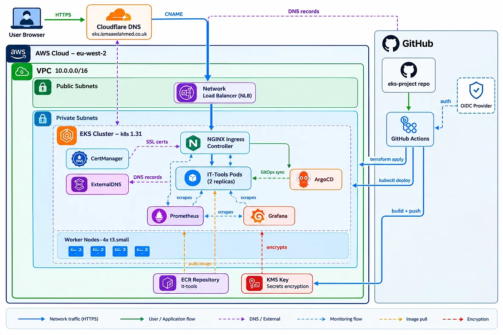

**Request path:** `User → Cloudflare DNS → AWS Network Load Balancer → NGINX Ingress → IT-Tools Service → 2 application pods`.

**Platform path:** `Terraform → AWS VPC / EKS / IAM` · `GitHub Actions → ECR / EKS` · `Argo CD → Git-sourced Kubernetes resources` · `Prometheus → Grafana`.

The **EKS control plane is AWS-managed**. Worker nodes and in-cluster services run on EC2 nodes in **private subnets**; public subnets support internet-facing load-balancing infrastructure. TLS termination and routing are handled through the Kubernetes ingress layer.

### Deployment Proof — Four Key Screenshots

These are the four outcomes I would show first in a technical interview. All four screenshots are preserved in this repository, with the full gallery in [Implementation Evidence](#implementation-evidence).

| 1. Application accessible over HTTPS | 2. Application deployment workflow |
| --- | --- |
| 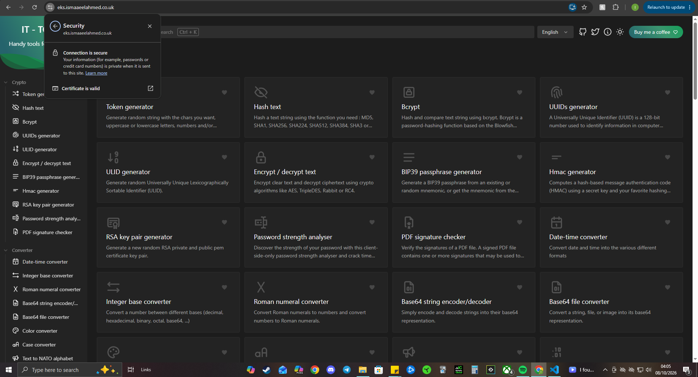 | 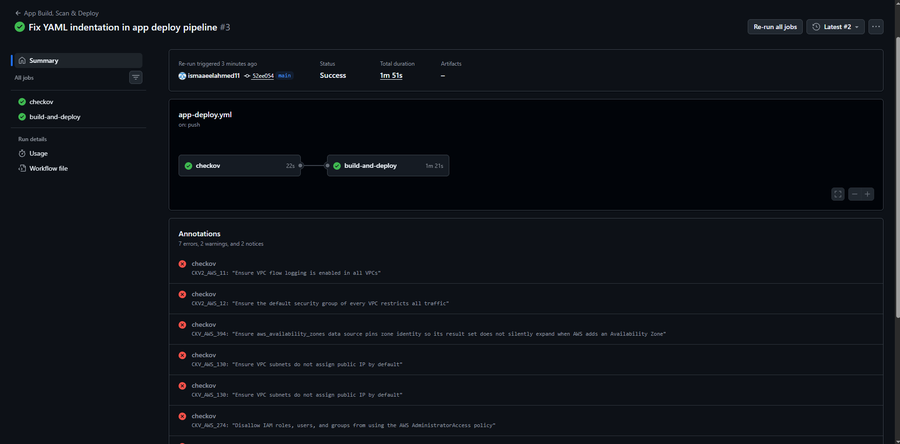 |
| Working application, custom hostname and TLS | Image published to ECR and deployment workflow completed; **security findings were non-blocking** |

| 3. Argo CD reconciliation | 4. Grafana observability |
| --- | --- |
| 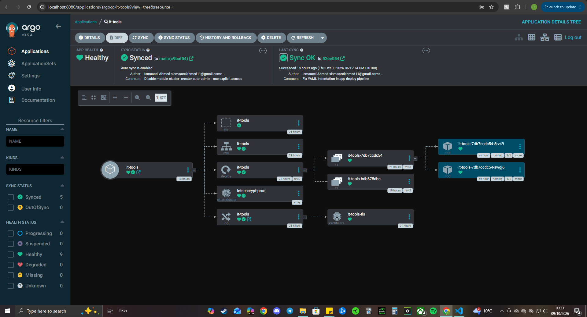 | 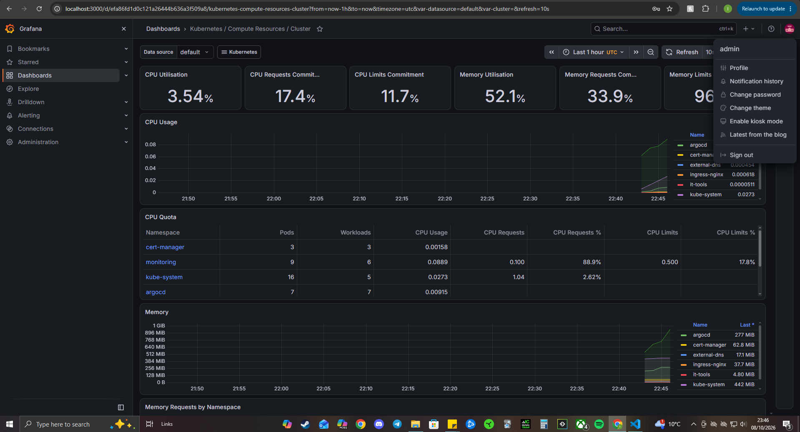 |
| Kubernetes resource tree and GitOps application status | Captured CPU, memory and namespace-level metrics |

> **Evidence note:** Green CI results mean the workflow completed; the Checkov/Trivy checks were configured as non-blocking. The separate node screenshot shows **two Ready nodes at an earlier stage**, while the final Terraform node-group configuration specifies **four desired nodes**. I distinguish configuration evidence from a snapshot of a running cluster.

## Skills Demonstrated — With Evidence

Rather than only listing technologies, the repository links each skill to working configuration or an observed result.

| Engineering skill | How I applied it | Where to verify |
| --- | --- | --- |
| **AWS / networking** | Built a VPC, public/private subnets, routing, NAT, IAM and an EKS environment | [`terraform/modules/vpc/`](terraform/modules/vpc/), [`terraform/modules/eks/`](terraform/modules/eks/) |
| **Terraform / IaC** | Used reusable modules, a remote S3 backend and workflow-based provisioning | [`terraform/`](terraform/), [Terraform apply workflow](.github/workflows/terraform-apply.yml) |
| **Kubernetes administration** | Configured application replicas, Services, Ingress, probes, requests and limits | [`k8s/`](k8s/), [application screenshot](screenshots/16-it-tools-deployed.png) |
| **CI/CD / GitHub Actions** | Automated Terraform changes, image publishing and Kubernetes deployment | [Workflows](.github/workflows/), [pipeline result](screenshots/21-app-deploy-pipeline-green.png) |
| **IAM / federated access** | Used AWS roles and GitHub OIDC in place of long-lived access keys | [`terraform/modules/oidc/`](terraform/modules/oidc/), [trust-policy evidence](screenshots/20a-oidc-trust-policy.png) |
| **GitOps / Argo CD** | Defined an application using Git as the desired-state source | [Argo CD Application](argocd/applications/it-tools.yaml), [resource tree](screenshots/29-argocd-ui.png) |
| **Monitoring / observability** | Deployed and debugged Prometheus/Grafana with persistent storage | [Monitoring Helm values](helm/monitoring/values.yaml), [Grafana](screenshots/27-grafana-dashboard.png) |
| **Troubleshooting** | Investigated scheduling, CSI storage, authentication and access configuration | [Root-cause investigations](#troubleshooting--root-cause-analysis), [before/after evidence](#storage-and-monitoring-recovery) |
| **Cost awareness** | Provided an explicit teardown workflow rather than leaving a paid cluster running | [Terraform destroy workflow](.github/workflows/terraform-destroy.yml) |

---

## Infrastructure & Design

### Platform inventory

| Component | Configuration |
| --- | --- |
| Region | `eu-west-2` (London) |
| EKS version | Kubernetes **1.31** in Terraform; actual patch versions varied across captured deployment stages |
| Managed node group | Desired **4 × `t3.small`**, minimum 1, maximum 5, over 2 private subnets |
| Networking | `10.0.0.0/16` VPC; 2 public + 2 private subnets across 2 AZs; internet gateway and NAT gateway |
| App workload | [IT-Tools](https://github.com/CorentinTh/it-tools), 2 replicas |
| Application networking | `containerPort: 80` → Service `targetPort: 80` → NGINX Ingress on service port 80 |
| Load balancing | AWS Network Load Balancer exposing the NGINX ingress controller |
| HTTPS / DNS | cert-manager, Let's Encrypt, ExternalDNS, Cloudflare |
| Image registry | Amazon ECR |
| GitOps | Argo CD automated `prune` / `selfHeal` |
| Metrics | Prometheus, Grafana, Alertmanager, node exporter, kube-state-metrics |
| Persistent volumes | Amazon EBS CSI Driver and EBS-backed claims for monitoring components |
| Terraform state | S3 backend with `use_lockfile = true` and encryption |

### Why EKS rather than stopping at ECS?

My earlier [AWS ECS Fargate project](https://github.com/ismaaeelahmed11/devops-learning/tree/main/ecs-project) covered AWS-native container delivery, infrastructure as code and CI/CD. For this project, I wanted to operate the **Kubernetes application and platform layer**: Pods, Services, Ingress, scheduling, Helm, GitOps, CSI storage and observability.

EKS gave me a managed Kubernetes control plane while leaving meaningful responsibility for workload configuration, node capacity and in-cluster services. I later complemented that with a separate [self-managed kubeadm lab](https://github.com/ismaaeelahmed11/kubeadm-kubernetes-lab) to work more directly with Kubernetes internals.

### Why deploy IT-Tools?

IT-Tools is a pre-existing, open-source application. I intentionally used an application with a clear HTTP interface so I could focus on **platform engineering rather than writing application features**. The project demonstrates deploying and operating a workload; it does not claim authorship of IT-Tools itself.

### Why four workers?

As more platform components were installed, some Pods could not schedule because of limited node resources. I checked workload scheduling and resource requirements, then changed the managed node group to a **desired size of four `t3.small` instances**.

This taught an important distinction: adding more application replicas is not a fix when the cluster lacks capacity for the supporting infrastructure. The four-node setting was a **capacity decision based on observed scheduling problems**, not a claim of tested autoscaling or production throughput.

### Availability and operational boundaries

Two AZs, two application replicas, readiness/liveness probes and resource requests/limits are valuable resilience practices. However, I did **not** benchmark failover time, implement multi-region recovery, validate backup restoration or run sustained load tests.

Likewise, the environment contains **a single NAT gateway** and includes administrative privileges that would need tighter scoping in a production deployment. These are documented improvement opportunities, not hidden assumptions.

---

## Infrastructure as Code — Terraform

Infrastructure was created through Terraform rather than being built entirely by clicking through the AWS Console.

The repository separates networking, EKS, Kubernetes service IAM and GitHub OIDC into modules:

```text
terraform/
├── main.tf
├── variables.tf
├── outputs.tf
├── provider.tf
├── backend.tf
└── modules/
    ├── vpc/
    ├── eks/
    ├── irsa/
    └── oidc/
```

### AWS networking

The VPC module configures DNS-enabled networking, public subnets for internet-facing resources, private subnets for worker nodes, route tables, an internet gateway and outbound NAT connectivity.

**Why private nodes?** The application can be exposed via a load balancer without giving each worker node a directly routable public IP.

### Terraform remote state

The Terraform backend uses an **S3 state file**, encryption and **S3-native lockfiles** (`use_lockfile = true`). The backend bucket was configured with versioning and public access blocked.

Remote state makes it possible for local Terraform operations and the GitHub Actions runner to refer to the same managed infrastructure state. Locking reduces the risk of conflicting changes. Backend creation, access policies and credentials must be arranged before initialising a fresh environment.

### Commands used

```bash
cd terraform
terraform init
terraform fmt -check
terraform validate
terraform plan
terraform apply
```

I reviewed plans and used Terraform outputs to inspect created infrastructure and connect subsequent Kubernetes tooling. The captured project-stage evidence includes a VPC plan of **14 resources** and a later EKS infrastructure plan of **33 additional resources**; these are point-in-time plan counts, not a promise that a current re-run will produce the same numbers.

**Evidence:** [Terraform init](screenshots/04-terraform-init.png) · [VPC plan](screenshots/05-terraform-plan-vpc.png) · [VPC apply](screenshots/06-terraform-apply-vpc.png) · [EKS plan](screenshots/08-terraform-plan-eks.png) · [EKS apply](screenshots/09-terraform-apply-eks.png)

---

## Kubernetes Application, Networking & HTTPS

### Workload configuration

The Kubernetes manifests define a namespace, Deployment, Service, Ingress and cert-manager ClusterIssuer. The application Deployment specifies:

- **2 replicas** behind a ClusterIP Service
- CPU requests/limits of **50m / 200m** per container
- Memory requests/limits of **64Mi / 128Mi** per container
- HTTP readiness and liveness probes on `/`
- Port **80** across the container and Service

See the actual [Deployment](k8s/deployment.yaml), [Service](k8s/service.yaml) and [Ingress](k8s/ingress.yaml) definitions.

### Request flow

1. A browser requests `https://eks.ismaaeelahmed.co.uk`.
2. Cloudflare resolves the hostname.
3. The AWS Network Load Balancer forwards traffic to NGINX Ingress.
4. The Ingress rule routes to the `it-tools` Service on port 80.
5. Kubernetes routes the request to an available IT-Tools Pod.
6. cert-manager manages the Let's Encrypt certificate referenced by the Ingress TLS configuration.

ExternalDNS uses a Cloudflare API token supplied through a Kubernetes Secret reference; the token itself is not intended to be committed to Git.

**Evidence:** [NGINX](screenshots/11-nginx-ingress-installed.png) · [cert-manager](screenshots/12-certmanager-installed.png) · [ClusterIssuer](screenshots/13-clusterissuer-ready.png) · [ExternalDNS](screenshots/14-externaldns-installed.png) · [ECR image](screenshots/15-it-tools-pushed-to-ecr.png) · [Deployment](screenshots/16-it-tools-deployed.png) · [HTTPS](screenshots/17-it-tools-live-https.png)

---

## CI/CD — GitHub Actions & AWS OIDC

Three workflows are stored under [`.github/workflows/`](.github/workflows/):

| Workflow | Trigger | Behaviour |
| --- | --- | --- |
| [`terraform-apply.yml`](.github/workflows/terraform-apply.yml) | Push to `main` affecting `terraform/**` or the workflow file; also manual | Terraform format check, init, validate, plan and **automatic apply** |
| [`app-deploy.yml`](.github/workflows/app-deploy.yml) | Push to `main` affecting `k8s/**`, `Dockerfile` or its workflow file; also manual | Checkov report, ECR image publication, Trivy report, Kubernetes apply and rollout status |
| [`terraform-destroy.yml`](.github/workflows/terraform-destroy.yml) | Manual `workflow_dispatch` with a required `destroy` confirmation | Terraform destroy of tracked infrastructure |

### Why OIDC matters

The workflows request short-lived AWS credentials by assuming an IAM role through **GitHub Actions OIDC**. This avoids storing permanent AWS access keys in GitHub repository secrets. The role and repository-claim trust conditions are represented in Terraform and supporting screenshots.

### What the application pipeline actually does

```text
Push / manual trigger
      |
      v
Checkov scans Terraform (reports findings; does not block)
      |
      v
Assume AWS role through OIDC
      |
      v
Pull upstream IT-Tools image from Docker Hub
      |
      v
Retag with the Git commit SHA and push to Amazon ECR
      |
      v
Trivy scans the published image (reports; does not block)
      |
      v
kubectl applies the Kubernetes manifests
      |
      v
kubectl rollout status checks the deployment
```

**Important accuracy point:** This pipeline **does not build IT-Tools from source**. It pulls an upstream image, retags it, publishes it to ECR and deploys it. The Git SHA is used as the **image tag**, but since the source image is pulled as `latest`, that tag alone does not establish a reproducible upstream build.

### Security checks: reporting vs enforcement

- **Checkov** is configured with `soft_fail: true`.
- **Trivy** scans `HIGH` and `CRITICAL` severities with `exit-code: '0'`.

That means the scans are integrated and produce useful findings, **but security findings do not fail this pipeline**. A successful workflow is evidence of successful automation—not a clean security assessment.

### Current automation trade-offs

The Terraform workflow uses `terraform apply -auto-approve` on pushes to `main`. For a team-operated environment I would add pull-request plans, approvals and protected environments, with apply separated from code review.

The app workflow also applies manifests directly with `kubectl`, while Argo CD separately reconciles the same `k8s/` directory. Additionally, the pipeline substitutes the commit-specific image tag **in the runner's local copy**, without writing that tag back to the Git source Argo CD watches. This can create **GitOps drift** or allow Argo CD to revert a direct deployment.

**Next improvement:** Move to a single deployment owner by publishing an immutable image digest/tag into a Git-managed manifest or overlay, and let **Argo CD** perform application reconciliation. This is a proposed improvement, **not something claimed as already implemented**.

**Evidence:** [Terraform workflow result](screenshots/20-terraform-pipeline-green.png) · [OIDC trust policy](screenshots/20a-oidc-trust-policy.png) · [application workflow result](screenshots/21-app-deploy-pipeline-green.png)

---

## GitOps — Argo CD

I configured an [Argo CD Application](argocd/applications/it-tools.yaml) to watch the repository's `k8s/` directory on `main` and reconcile resources into the `it-tools` namespace.

Its policy includes:

```yaml
syncPolicy:
  automated:
    prune: true
    selfHeal: true
  syncOptions:
    - CreateNamespace=true
```

I observed the IT-Tools Application reaching **Synced** and **Healthy**, with its underlying Kubernetes resource tree visible in the Argo CD UI.

This demonstrates **declarative desired-state management** and GitOps reconciliation. It does not by itself prove a complete GitOps-only release process because the existing GitHub Actions workflow also performs a direct deployment; the ownership gap is explained above.

**Evidence:** [Argo CD installed](screenshots/23-argocd-installed.png) · [Synced and Healthy](screenshots/24-argocd-synced.png) · [resource tree](screenshots/29-argocd-ui.png)

---

## Monitoring & Observability

I deployed the `kube-prometheus-stack` Helm chart to gain visibility into both Kubernetes infrastructure and workloads.

The configuration covers **Prometheus**, **Grafana**, **Alertmanager**, **node exporter** and **kube-state-metrics**. Monitoring components use persistent storage definitions, including a Prometheus data volume and Grafana persistence.

The captured Grafana dashboard exposed cluster and namespace-level **CPU and memory utilisation**. At the moment of the screenshot, the dashboard displayed approximately **3.54% CPU** and **52.1% memory**. These numbers are **a snapshot**, not load-testing results or a performance SLA.

### Storage and monitoring recovery

Monitoring initially failed to schedule correctly because the cluster had unmet persistent-storage requirements and capacity constraints. I investigated the Pending workloads and PVCs, configured the **Amazon EBS CSI Driver and its IAM permissions** and addressed node capacity. The monitoring pods subsequently reached a running state.

| Before — workloads Pending | After — monitoring workloads Running |
| --- | --- |
| 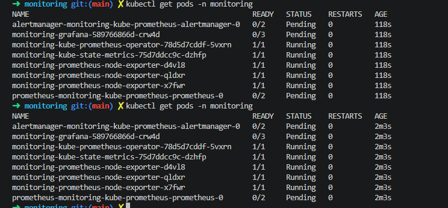 | 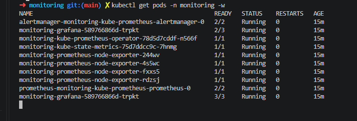 |

**Outcome:** A working monitoring stack and a better understanding of how EKS add-ons, IAM, Kubernetes storage and scheduling interact.

---

## Troubleshooting & Root Cause Analysis

The purpose of documenting incidents is to show **how I investigated failures and decided what to change**, not simply to list commands that worked.

| Incident | What I investigated | Action / lesson |
| --- | --- | --- |
| **Workloads `Pending`** | Pod scheduling, node resources, supporting add-on footprint | Increased managed node-group capacity to a desired 4 workers; platform add-ons need capacity too |
| **PVCs `Pending`** | Claims, StorageClass/EBS CSI availability and IAM | Configured the EBS CSI Driver with the required permissions; storage depends on both Kubernetes and AWS |
| **GitHub Actions authentication** | OIDC role trust, subject claims and AWS IAM | Updated trust-policy conditions to match the GitHub Actions context; identity configuration must match the issued claims |
| **EKS access conflicts** | Automatic cluster-creator permissions vs explicit access entries | Removed conflicting automatic permissions and managed EKS access entries explicitly |
| **Container/Service ports** | Relationship between application listener, Service target port and external HTTPS listener | Aligned the final published Deployment and Service on **port 80**; external TLS does not require the container itself to listen on 443 |

### 1. Cluster capacity — not every Pending Pod is an application bug

As NGINX, Argo CD, cert-manager, ExternalDNS and monitoring were added, the resource demands grew. I reviewed scheduling and node capacity, then increased the node group. **Lesson:** diagnose scheduling constraints before changing application code or replicas.

### 2. EBS CSI — a Kubernetes cluster does not automatically guarantee persistent storage

Persistent volume claims remained unresolved until the AWS storage integration and permissions were corrected. **Lesson:** cloud-specific CSI drivers, StorageClasses, node placement and IAM are part of the application's operational dependency chain.

### 3. OIDC — AWS authentication requires matching trust conditions

I investigated failures in the GitHub-to-AWS role assumption, checked the trust policy and adjusted subject-claim conditions. **Lesson:** federated access needs deliberate audience/subject conditions and least-privilege permissions, not merely a configured role ARN.

### 4. EKS access — one clear source of authorisation

The Terraform module's creator-admin setting conflicted with explicitly configured EKS access entries. I disabled the conflicting setting and used explicit entries. **Lesson:** identity, access and Kubernetes authorisation must be designed together.

### 5. Port alignment — distinguish container, Service and ingress listeners

An earlier iteration involved an application-port/configuration issue. I traced traffic through the container, Kubernetes Service and external ingress. **The final committed manifests specify port 80 throughout the application/Service path**, with TLS configured at ingress; an earlier note describing port 8080 does not match the published configuration.

> **What these incidents taught me:** Kubernetes failures often originate outside the application—in **IAM, VPC networking, scheduling, persistent storage, controllers or automation**. Debugging across layers was the main engineering skill I developed here.

---

## Repository Structure

```text
eks-project/
├── .github/workflows/
│   ├── terraform-apply.yml
│   ├── terraform-destroy.yml
│   └── app-deploy.yml
├── argocd/applications/
│   └── it-tools.yaml
├── helm/
│   ├── ingress-nginx/
│   ├── cert-manager/
│   ├── external-dns/
│   ├── argocd/
│   └── monitoring/
├── k8s/
│   ├── namespace.yaml
│   ├── deployment.yaml
│   ├── service.yaml
│   ├── ingress.yaml
│   └── cluster-issuer.yaml
├── terraform/
│   ├── main.tf
│   ├── variables.tf
│   ├── outputs.tf
│   ├── provider.tf
│   ├── backend.tf
│   └── modules/
│       ├── vpc/
│       ├── eks/
│       ├── irsa/
│       └── oidc/
├── screenshots/
├── .gitignore
└── README.md
```

## Reproducing the Environment (Reference Guide)

> **Read before deploying:** This repository documents the configuration used for the completed project; it is **not guaranteed to deploy unchanged today**. The original environment has been removed. Review current EKS/Kubernetes version support, provider/module/chart compatibility, AWS permissions, account-specific ARNs, cluster access entries and billing before provisioning anything. The repository uses **EKS v1.31** and contains environment-specific account references.

### Prerequisites

- AWS account and AWS CLI with appropriate permissions
- Terraform compatible with the repository configuration
- `kubectl`, Helm 3 and container tooling
- Access to an S3 state bucket and corresponding IAM permissions
- Cloudflare-managed domain and securely supplied API token
- GitHub OIDC/IAM role setup if using Actions
- Budget and teardown plan for EKS, EC2, NAT Gateway, load balancer and EBS charges

### 1. Clone and inspect

```bash
git clone https://github.com/ismaaeelahmed11/eks-project.git
cd eks-project

# Review configuration before running Terraform
ls terraform
```

Update account-specific IAM identifiers, the state backend and any version-sensitive values **in the appropriate Terraform/configuration files** before deployment. Do not paste credentials or tokens into Git.

### 2. Provision infrastructure

```bash
cd terraform
terraform init
terraform fmt -check
terraform validate
terraform plan
# Review the plan and estimated charges before approving:
terraform apply
cd ..
```

The S3 backend must exist and be accessible before `terraform init`.

### 3. Connect to EKS

```bash
aws eks update-kubeconfig \
  --name eks-project-cluster \
  --region eu-west-2

kubectl get nodes
kubectl get pods -A
```

### 4. Install and configure platform add-ons

Review the respective directories in [`helm/`](helm/) for NGINX Ingress, cert-manager, ExternalDNS, Argo CD and monitoring. Apply the appropriate **current chart versions and values** in dependency order. Configure the EBS CSI add-on, relevant IAM permissions and StorageClass before expecting persistent monitoring claims to bind.

For ExternalDNS, provide the Cloudflare token as a Kubernetes Secret with the name/key referenced in its Helm values; never commit the value.

### 5. Deploy and verify application resources

After the prerequisite CRDs, ingress and DNS/certificate services are available:

```bash
kubectl apply -f k8s/namespace.yaml
kubectl apply -f k8s/cluster-issuer.yaml
kubectl apply -f k8s/deployment.yaml
kubectl apply -f k8s/service.yaml
kubectl apply -f k8s/ingress.yaml

kubectl get deployments -n it-tools
kubectl get pods -n it-tools
kubectl get ingress -n it-tools
kubectl get certificates -A
kubectl get pvc -A
```

The image reference in [`k8s/deployment.yaml`](k8s/deployment.yaml) is account-specific. Republish the IT-Tools image to an accessible registry or adjust the manifest before recreating the deployment.

### 6. Configure Argo CD

```bash
kubectl apply -f argocd/applications/it-tools.yaml
```

Inspect Application health/sync status in Argo CD. For a future **GitOps-only** setup, do not also change those same resources by direct CI `kubectl apply`: manage the image version in Git and allow Argo CD to reconcile it.

### 7. Verify the platform

```bash
kubectl get nodes -o wide
kubectl get pods -A
kubectl get ingress -A
kubectl get certificates -A
kubectl get pvc -A
kubectl rollout status deployment/it-tools -n it-tools
```

Check HTTPS access, dashboard data and Actions logs; resolve any version/API/permissions differences before considering the redeployment complete.

### 8. Teardown and cost checks

The [manual destroy workflow](.github/workflows/terraform-destroy.yml) requires the confirmation text `destroy`. A teardown is **destructive** and only targets resources managed in the associated Terraform state. Afterwards, inspect AWS and Cloudflare for any retained state-bucket, EBS, load-balancer, public IP or DNS resources and associated charges.

---

## Operational Trade-offs & Next Improvements

| Area | Present in this project | Next engineering improvement |
| --- | --- | --- |
| **Infrastructure changes** | Push-to-`main` Terraform apply with `-auto-approve` | Protected environments, PR plans, approvals and reviewed applies |
| **App delivery / GitOps** | Direct Actions deployment **and** Argo CD reconciliation | Git-driven release updates with one deployment owner and immutable image digests |
| **Security scanning** | Checkov and Trivy report findings | Remediate findings and enforce risk-based failing thresholds |
| **Image provenance** | Retags Docker Hub `latest` using commit SHA in ECR | Pin and verify an upstream image digest; add provenance/SBOM as appropriate |
| **IAM** | OIDC roles and explicit EKS access entries | Scope administrative access and permissions more narrowly |
| **Availability** | 2 AZs, 2 app replicas, 4 configured worker nodes | Exercise node failures, PodDisruptionBudgets, backups and recovery |
| **Cost / networking** | Single NAT gateway, fixed small workers, teardown workflow | Compare NAT/high-availability trade-offs, autoscaling and cost observability |
| **Observability** | Prometheus/Grafana dashboards and Alertmanager installed | Test meaningful alerts, incident runbooks, SLOs and retention |
| **Reproducibility** | Terraform/manifests/Helm values preserved | Pin/upgrade supported EKS and chart versions; remove account-specific identifiers |

**These are future improvements**, not completed features. Naming limitations is part of making a technical project reviewable and trustworthy.

---

## Cost Management

EKS has ongoing costs even with little or no user traffic. The original demonstration's rough estimate was approximately **$6.50/day**, factoring in the EKS control plane, four EC2 workers, NAT and load balancing. This was a historical estimate, **not a current quote**; actual rates and support-tier charges change.

I intentionally kept the deployment time-limited, preserved walkthrough and screenshot evidence, added a controlled destroy workflow and removed the paid environment after completion. This is why the historical application domain should **not** be treated as an active demo.

---

## Implementation Evidence

**25 project evidence screenshots** are organised below by engineering concern. The four outcomes at the top are repeated intentionally so a reviewer can understand the result without opening this gallery. Screenshots document specific moments; they do not replace the source code or imply ongoing service availability.

<details>
<summary><strong>1. Terraform & AWS infrastructure — 7 screenshots</strong></summary>

### Repository layout
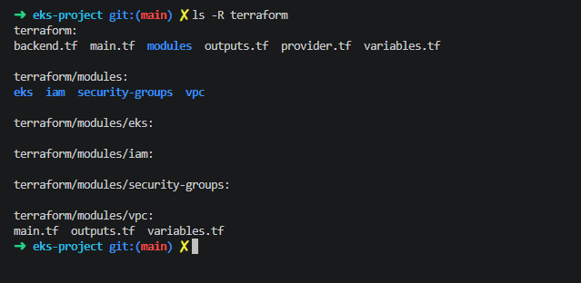

### S3 state backend
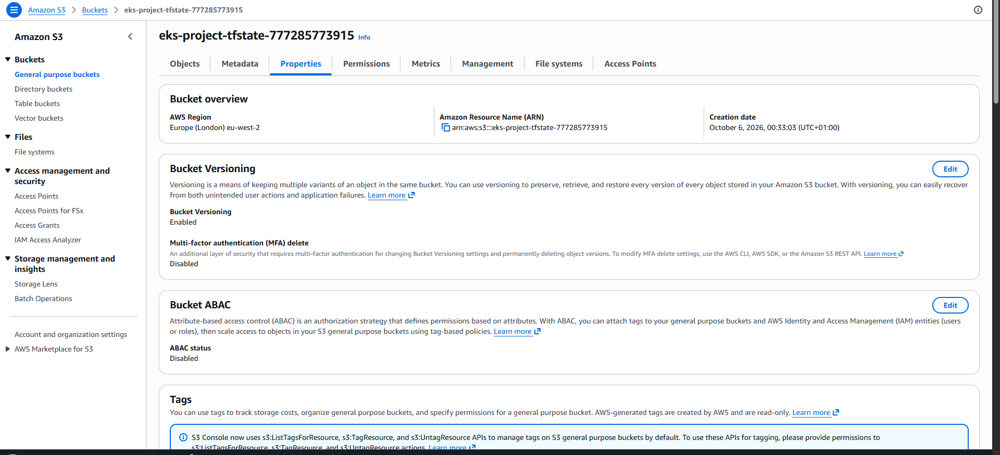

### Terraform initialisation
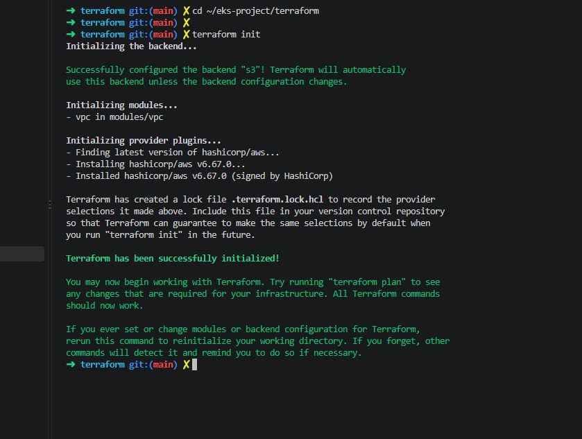

### VPC plan
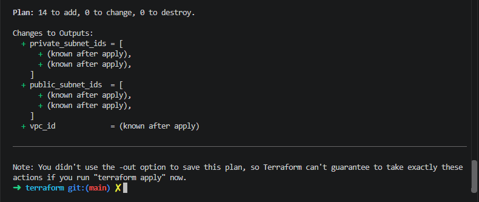

### VPC apply
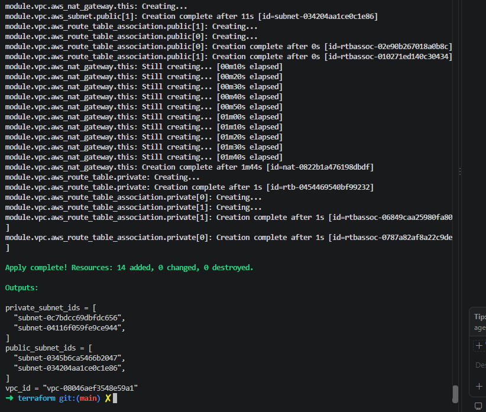

### EKS plan
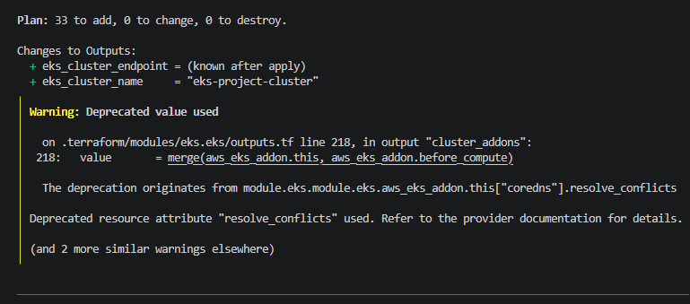

### EKS apply
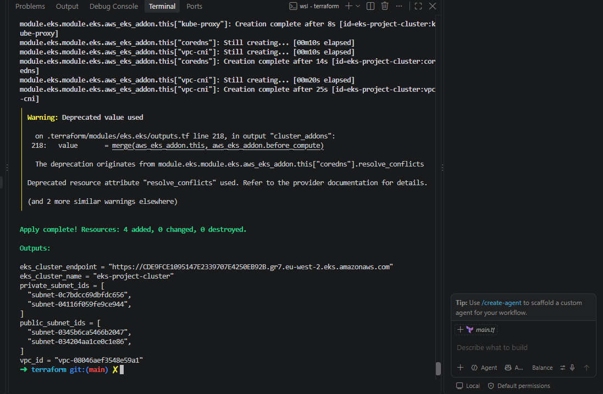

</details>

<details>
<summary><strong>2. Kubernetes, networking & HTTPS — 8 screenshots</strong></summary>

### Earlier worker-node snapshot (two nodes)

This screenshot captures **two Ready nodes during an earlier deployment stage**. The [final Terraform configuration](terraform/modules/eks/variables.tf) specifies a **desired size of four**. I have deliberately labelled the screenshot by its actual contents rather than describing it as proof of four Ready nodes.

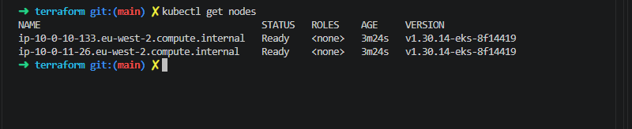

### NGINX Ingress
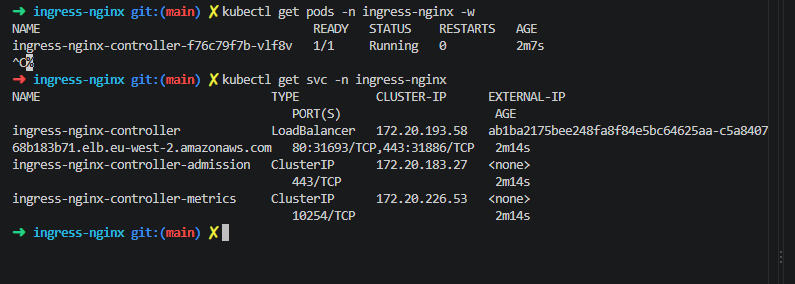

### cert-manager
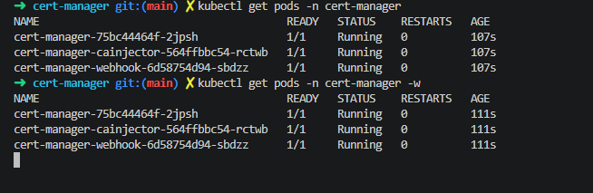

### Let's Encrypt ClusterIssuer
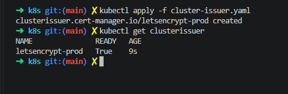

### ExternalDNS
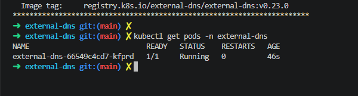

### Image in ECR
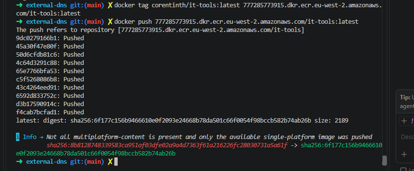

### IT-Tools Deployment
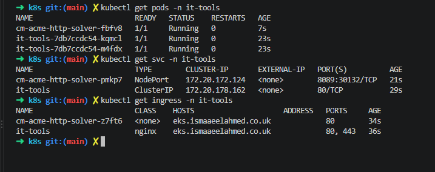

### Application accessible over HTTPS


</details>

<details>
<summary><strong>3. CI/CD & AWS authentication — 3 screenshots</strong></summary>

### Terraform workflow succeeded
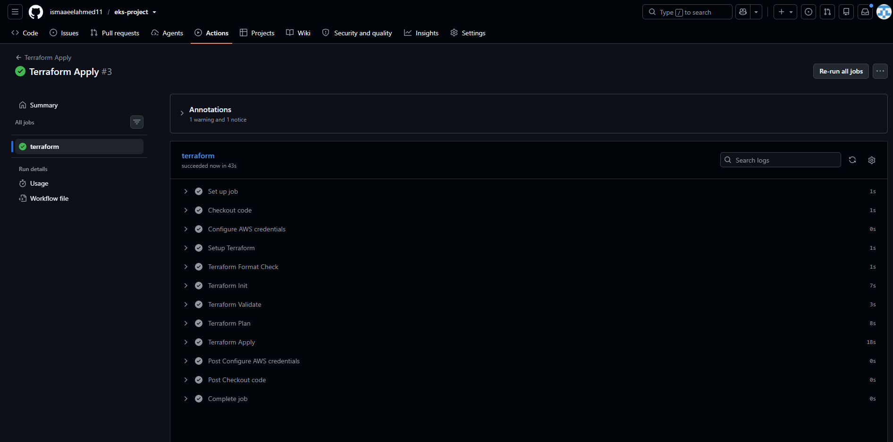

### OIDC trust policy
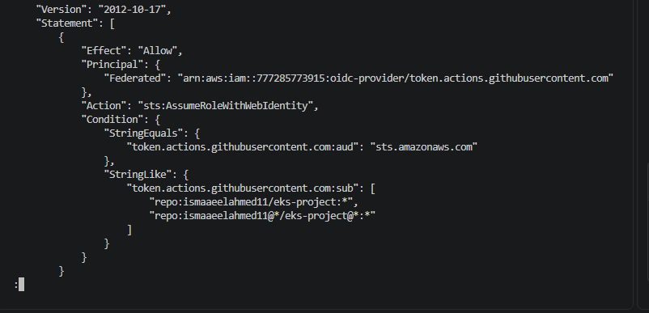

### Application pipeline succeeded

Scan steps were configured as **non-blocking**; workflow success means the job finished, not that all findings passed a policy gate.


</details>

<details>
<summary><strong>4. Argo CD GitOps — 3 screenshots</strong></summary>

### Argo CD components
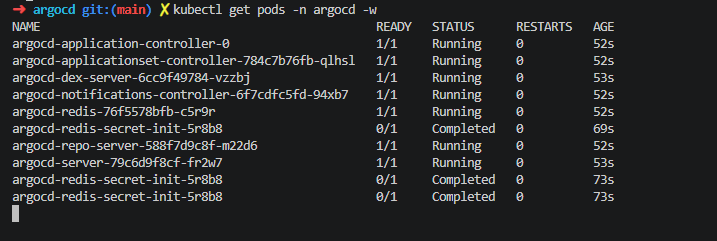

### Application Synced and Healthy
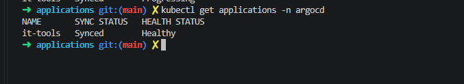

### Application resource tree


</details>

<details>
<summary><strong>5. Observability & recovery — 3 screenshots</strong></summary>

### Initial Pending monitoring workloads


### Workloads recovered


### Grafana resource metrics


</details>

<details>
<summary><strong>6. Project delivery — 1 screenshot</strong></summary>

### GitHub project board
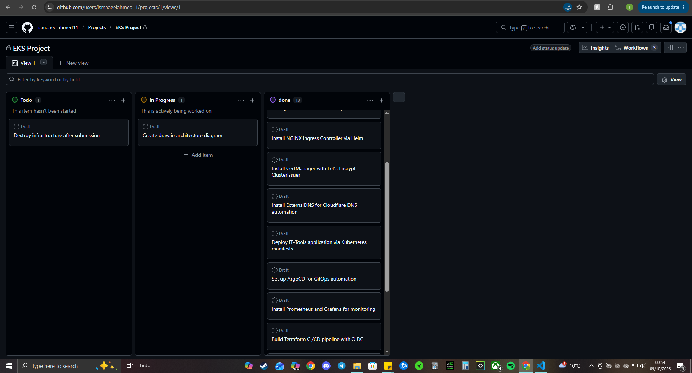

</details>

---

## Project Planning

I tracked provisioning, Kubernetes configuration, automation, monitoring, troubleshooting and documentation using a GitHub Projects board.

**[View the project board](https://github.com/users/ismaaeelahmed11/projects/1)**

## Engineering Outcomes & Interview Discussion

This project joined together **AWS infrastructure, Kubernetes operations, CI/CD, GitOps and observability**. More importantly, it forced me to debug interactions between them.

A `Pending` Pod can signal capacity or storage problems; a failed deployment can originate in **AWS IAM/OIDC** instead of Kubernetes YAML; a green pipeline can still have **non-blocking security findings**; and two independent deployment controllers can disagree about the desired application state.

This project gives me practical examples to discuss in **Junior DevOps, Cloud, Infrastructure, SRE and Platform Engineering** interviews: how I diagnosed a `Pending` Pod, how OIDC trust conditions work, why persistent volumes failed, what Argo CD reconciles and where CI/CD needs stronger release controls.

**Project context:** Completed during the **CoderCo DevOps Engineering programme (January–October 2026)**, alongside practical portfolio work. This repository documents a time-limited lab deployment using real AWS resources—not claimed commercial work experience.

### Related work

- [AWS ECS Fargate — Terraform, Docker & CI/CD](https://github.com/ismaaeelahmed11/devops-learning/tree/main/ecs-project)
- [Self-managed Kubernetes — kubeadm & cluster operations](https://github.com/ismaaeelahmed11/kubeadm-kubernetes-lab)
- [GitHub profile and DevOps portfolio](https://github.com/ismaaeelahmed11)

---

**Ismaaeel Ahmed** · DevOps & Cloud Engineering  
[GitHub Portfolio](https://github.com/ismaaeelahmed11) · [LinkedIn](https://www.linkedin.com/in/ismaaeelahmed) · [Email](mailto:ismaaeelahmed11@gmail.com) · [Video walkthrough (2:29)](https://youtu.be/RDmnaTi2auE)
